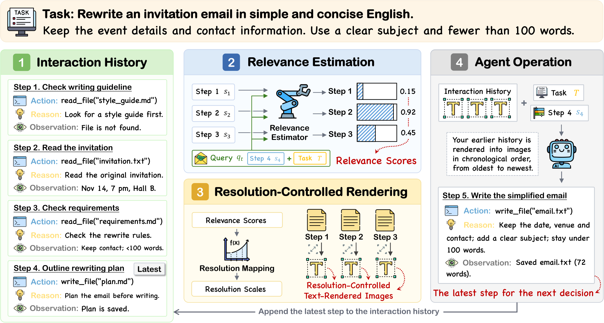

<p align="center">
  
</p>

<h1 align="center">Resolution as Attention for Efficient Agent Memory Perception</h1>

<p align="center">
  <a href="https://arxiv.org/abs/2611.24422"></a>
  <a href="https://sxiangag.github.io/resolution-as-attention/"></a>
</p>

This is the official repository for the paper *Resolution as Attention for Efficient Agent Memory Perception*.

## 🔎 Overview

Resolution as Attention (RAA) is a memory perception mechanism that uses visual resolution as a means of attention allocation across interaction histories. RAA renders past interactions as images and dynamically adjusts their resolution at every step according to their relevance to the agent's upcoming decision, preserving fine-grained information for critical interactions while reducing visual-token consumption for less relevant ones.

<p align="center">
  <a href="docs/assets/overview.png"></a>
</p>

## ✨ Key Features

- **Relevance estimation**: a 0.6B estimator, fine-tuned from Qwen3-Reranker, scores every past interaction against the task and the latest step.
- **Resolution-controlled rendering**: a learnable sigmoid maps each score to a scale, and each interaction is rendered once as a canonical image and resized to that scale before the agent perceives it.
- **Plug-in perception layer**: RAA transfers to off-the-shelf vision-capable agents and composes with existing memory management methods.

## 🚀 Code

The full code will be released upon the acceptance of the paper.

## 📝 Citation

```bibtex
@article{xiang2026resolution,
  title   = {Resolution as Attention for Efficient Agent Memory Perception},
  author  = {Xiang, Siqi and Xu, Zhipeng and Liu, Shengrui and Chen, Zulong and Miao, Chunyan and Lu, Shijian},
  journal = {arXiv preprint arXiv:2611.24422},
  year    = {2026},
  url     = {https://arxiv.org/abs/2611.24422}
}
```
